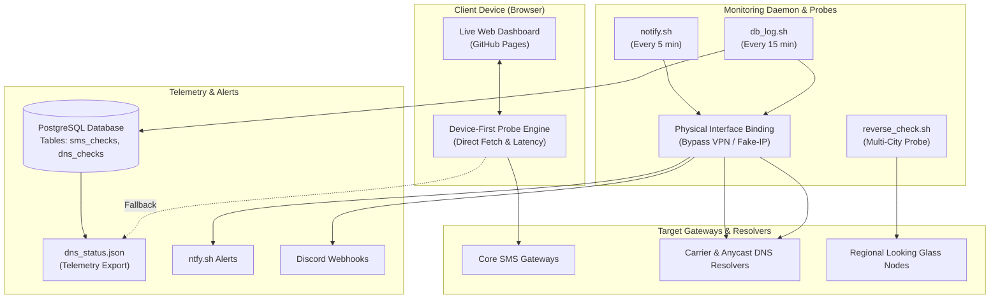

# SMS Gateway & Infrastructure Health Monitor

A real-time availability, DNS propagation, latency benchmark, and multi-carrier visibility monitoring suite for high-volume SMS gateways and telecommunication switches.

## Overview

This monitoring engine runs continuous health probes, DNS resolution verification across multiple ISPs and Anycast resolvers, and automated latency tracking:

1. **SMS Endpoint Heartbeats**: Automated health checks against REST and SMPP messaging endpoints, login panels, and upstream carrier HTTP APIs.
2. **Multi-Carrier DNS Resolution**: Verifies that gateway hostnames consistently resolve to designated target IP addresses across major telecom providers, regional ASNs, and global resolvers.
3. **Multi-Region Looking Glass Probes**: External reachability probes testing gateway visibility across geographically distributed networks.
4. **Dual-Engine Telemetry Dashboard**: A browser dashboard that executes direct client-side fetch probes and falls back to server-side telemetry when sandboxed or offline.
5. **Real-Time Incident Notifications**: Multi-channel alerting via Discord webhooks and `ntfy` push notifications upon route drops or latency spikes.

## Architecture



## Quick Start

### 1. Configure Target Endpoints

Set your environment variables or edit `check.sh`:

```bash
export GATEWAY_TARGET_HOST="sms.example.com"
export GATEWAY_TARGET_IP="192.0.2.1"
export NTFY_TOPIC="your-alerts-topic"
export DISCORD_WEBHOOK_URL="https://discord.com/api/webhooks/..."
```

### 2. Run Health Check

```bash
./check.sh
```

### 3. Start PostgreSQL Telemetry Logger

```bash
cd docker && docker compose up -d
./db_log.sh
```

## Tech Stack

- **Probes**: Bash, `curl`, `dig`, `drill`, Python 3
- **Data Store**: PostgreSQL
- **Frontend Dashboard**: HTML5, Vanilla JavaScript, Chart.js
- **Alert Channels**: Discord Webhook, `ntfy` Push
